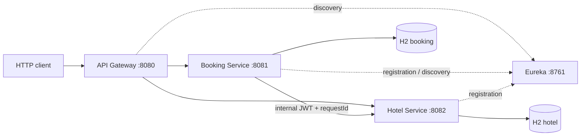
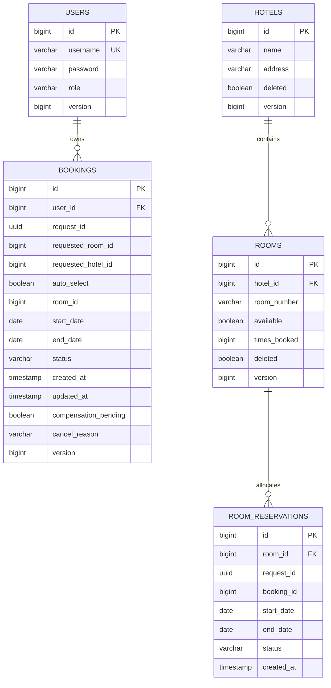
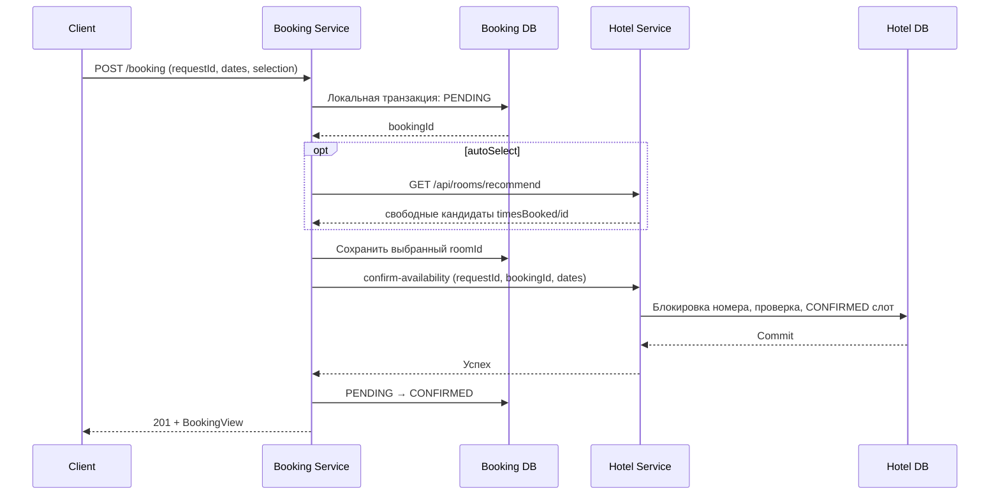
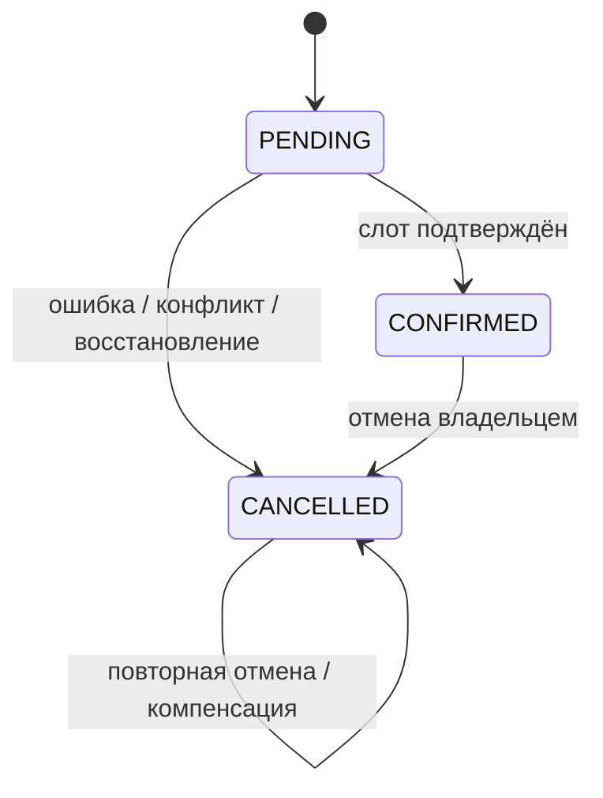

# Архитектура и данные

## Границы сервисов

`Booking Service` владеет пользователями и пользовательскими бронированиями. `Hotel Service` владеет каталогом и календарём занятости. Gateway проверяет внешний JWT, проксирует только явно объявленные маршруты и сохраняет `Authorization`; бизнес-сервисы самостоятельно проверяют токен и методовые права. Eureka выполняет обнаружение, не участвуя в согласовании бронирований.

Модуль `common` содержит только общую инфраструктуру MVC-сервисов: ошибки, JWT, обработку безопасности и корреляцию. Сущности JPA и бизнес-репозитории принадлежат своим сервисам. Gateway имеет реактивную реализацию тех же контрактов без зависимости от Servlet-кода.

## Схема данных

Связи в диаграмме — локальные FK внутри соответствующей БД. Числовые `roomId` в Booking и `bookingId` в Hotel являются внешними идентификаторами без межсервисного FK.

В поле `password` хранится BCrypt-хеш, а не исходный пароль.

| Ограничение/индекс | Назначение |
|---|---|
| `uk_users_username` | Уникальный логин |
| `uk_booking_request (user_id, request_id)` | Один бизнес-запрос пользователя — одна запись бронирования |
| `ix_booking_user_created (user_id, created_at)` | История пользователя |
| `ix_booking_recovery (status, updated_at)` | Поиск зависших `PENDING` |
| `ix_booking_compensation (compensation_pending)` | Очередь незавершённых освобождений |
| `uq_room_number (hotel_id, room_number)` | Уникальный номер внутри отеля |
| `idx_room_selection (hotel_id, available, times_booked)` | Отбор кандидатов |
| `uq_reservation_request (room_id, request_id)` | Идемпотентность допуска/освобождения номера |
| `idx_slot_overlap (room_id, status, start_date, end_date)` | Поиск пересекающихся занятых интервалов |

Проверка пересечения для полуоткрытых интервалов: `existing.startDate < requested.endDate && existing.endDate > requested.startDate`. Одного уникального ключа недостаточно для запрета пересечений: `RoomAllocationService` блокирует строку номера `PESSIMISTIC_WRITE`, проверяет календарь и вставляет слот в одной транзакции. Параллельные запросы к разным номерам могут выполняться независимо. `@Version` дополнительно защищает изменение сущностей от потерянного обновления.

## Создание бронирования

Локальные транзакции вынесены в `BookingStateService`; координатор `BookingService` вызывает HTTP за их пределами. Повторный `requestId` проверяется под блокировкой строки пользователя и возвращает существующую бронь. Изменение исходного payload для того же ключа даёт `409`. При автоматическом подборе конфликт конкретного номера приводит к попытке следующего кандидата. Сортировка обеспечивает детерминированный приоритет и сглаживает накопленное число бронирований; глобального оптимизатора размещения и строгой очереди всех клиентов нет.

## Сбои и восстановление

При сбое после сохранения `roomId` координатор отменяет бронь и освобождает соответствующий слот. Потеря ответа не позволяет определить, выполнен ли удалённый запрос; поэтому `release` идемпотентен и сохраняет `RELEASED` tombstone, если `confirm` ещё не получен. Поздний `confirm` с тем же ключом отклоняется, а повторный `release` не уменьшает счётчик второй раз.

Неудачная компенсация оставляет `compensationPending=true`. `BookingRecovery` каждые 5 секунд повторяет освобождения; `PENDING`, не обновлявшиеся 60 секунд, отменяет. Параметры настраиваются в `booking.recovery.*`. Это локальная сохраняемая очередь в БД Booking, не отдельный брокер и не полноценная таблица transactional outbox.

HTTP-клиент использует ограниченные connect/read timeout, до трёх попыток с экспоненциальной задержкой и Circuit Breaker. Обычные бизнес-конфликты не повторяются как временные ошибки. Компенсация обходит Circuit Breaker допуска новых бронирований, но сохраняет тайм-ауты и ограничение повторов. Исчерпание повторов не удаляет признак незавершённой компенсации.

Общей атомарной транзакции между сервисами нет: во время сбоя возможна кратковременная разница между состояниями брони и слота. Для постоянных БД восстановление могло бы продолжиться после рестарта; текущая H2 in-memory теряет эти записи. Масштабирование бизнес-сервисов с независимой H2 у каждого экземпляра не поддерживается: экземпляры одного сервиса должны использовать одну постоянную БД, чтобы блокировки и ограничения были общими.

## Статистика и ограничения

Hotel вычисляет статистику по своему календарю, без чтения БД Booking. Подтверждённые интервалы пересекаются с запрошенным периодом; сумма ночей делится на `число неудалённых номеров × ночи периода`. В ответе есть суммарная и поэлементная загрузка, текущее число эксплуатационно доступных номеров и `timesBooked`.

Исторического календаря ремонтов нет, поэтому текущий `available=false` не уменьшает историческую ёмкость. Мягко удалённые номера исключаются из текущего статистического отчёта. Эти ограничения отражают учебную модель и должны учитываться при интерпретации процентов.

Для дальнейшего развития нужны постоянные БД с миграциями, отдельные секреты окружений и TLS, эксплуатационные метрики и распределённая трассировка. В текущем проекте сознательно не вводятся брокер сообщений, Kubernetes, общая БД или распределённые блокировки поверх локальных H2.
